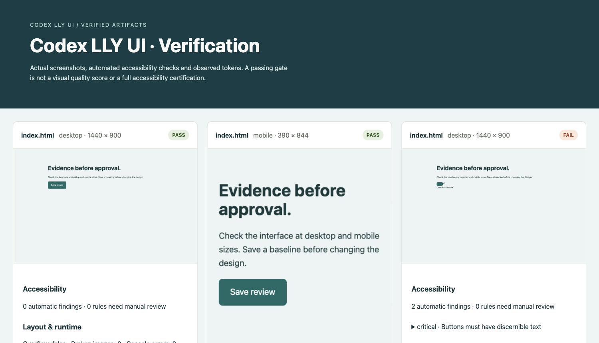
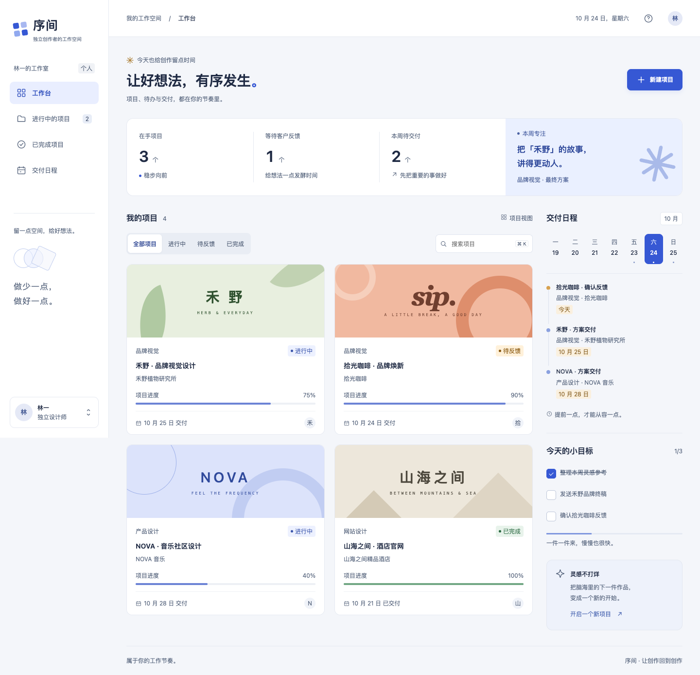
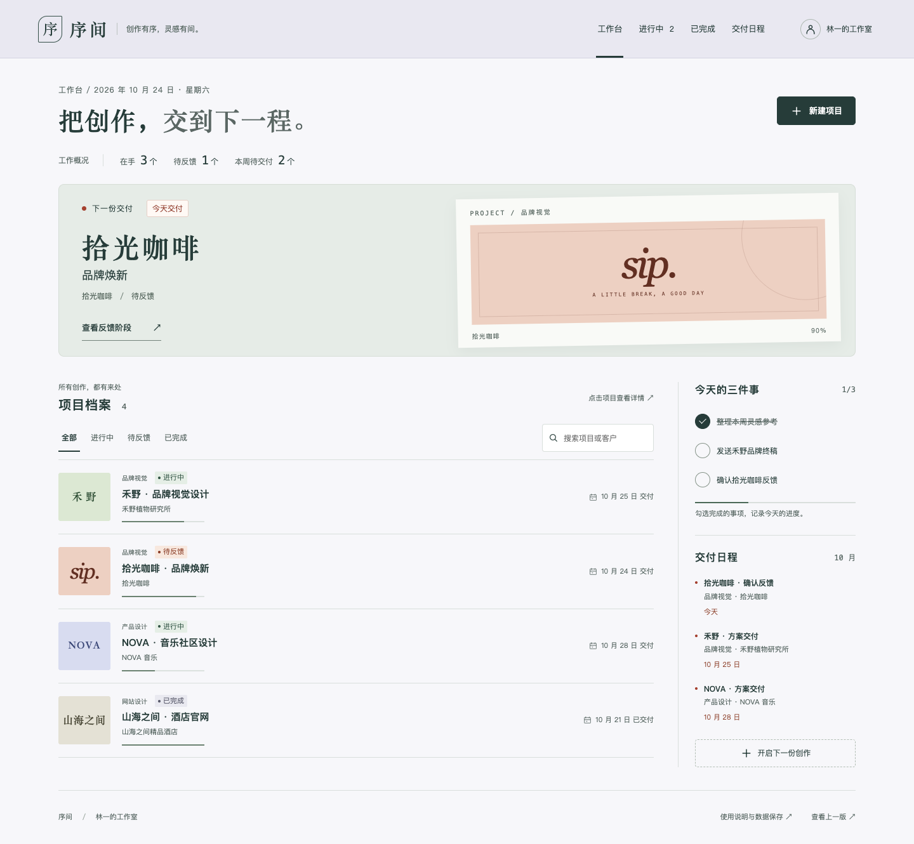

# codex-lly-ui

**从设计决策到可核验的界面交付。**

将 Oil UI 成熟设计方法适配到 Codex 的 UI 设计与验收插件，维护者 **lly**。围绕目标用户、主操作和真实界面证据工作，提供 8 个本地 MCP 工具。免费，MIT 开源。

## 设计流程

```text
设计约束 → 方向比较 → 完整实现 → 交互实测 → 自动审计 → 视觉回归 → 验收报告
```

- **先记录判断**：目标、受众、主操作、限制及不同构图的方向卡。
- **比较真实画面**：渲染 2–4 个候选，生成可离线打开、可选择方向、可检查原尺寸的比较页。
- **观察真实操作**：点击、填写、键盘与等待指定元素，保留操作后截图、正文和焦点位置。
- **多端自动审计**：axe 无障碍规则、横向溢出、断图、运行时错误，以及实际颜色、字体、间距和 CSS 变量。
- **保护视觉基线**：保存认可版本，核验文件哈希，按视口生成像素差异图和门槛结果。
- **保留交付证据**：离线报告含真实截图与问题，附 SHA-256 文件清单；素材另有来源和署名记录。

机器检查、人工视觉判断与业务流程验收分别记录。自动通过不代表界面好看、全面 WCAG 合规或业务逻辑正确。



上图来自实际工具运行，使用正常与故障测试页面展示检查结果，不是客户案例或完整产品设计。

## 安装

在 Codex 插件目录选择“添加插件市场”，输入 `a789b1/codex-lly-ui`，Git ref 选 `main`，安装 **Codex LLY UI**。支持的 CLI 也可运行：

```sh
codex plugin marketplace add a789b1/codex-lly-ui
codex plugin add codex-lly-ui@codex-lly-ui
```

在新聊天中选用插件。要求 **Node.js 22.19+** 和 Chrome/Chromium/Edge；可用 `CHROME_PATH` 指定浏览器。发布包已包含 MCP 服务及依赖，MCP 工具无需 npm 安装；可交互方案比较需要 Python 3.10+。不依赖 DeepSeek 或付费 UI 技能。

只通过 GitHub 分发，**未提交 OpenAI 官方公共插件目录**。仓库市场安装与官方目录上架是不同渠道。

## 使用

- “给这个预约产品确定目标和主要操作，探索三个不同构图的方向。”
- “把三个候选做成同屏比较页，让我按实际画面选。”
- “检查手机上的表单错误和键盘操作，再生成验收报告。”
- “用已认可的版本作基线，列出这轮改版的截图差异。”

| 工具 | 作用 |
| --- | --- |
| `lly_ui_status` | 检查实际 Node、浏览器和工具可用性 |
| `lly_ui_brief` | 保存设计目标、限制、方向卡和验收约定 |
| `lly_ui_explorer` | 渲染候选截图，生成独立方向比较页 |
| `lly_ui_capture` | 实际操作、截图、正文与焦点观察 |
| `lly_ui_audit` | 多视口自动审计及设计变量提取 |
| `lly_ui_baseline` | 基线保存、哈希核验和像素回归 |
| `lly_ui_report` | 离线验收报告与证据文件清单 |
| `lly_ui_assets` | 为已有素材登记来源、许可声明和署名 |

所有工具显式接收用户项目绝对路径 `cwd`；同一工作区按顺序执行，避免缓存和证据冲突。截图与审计使用新目录，设计简报默认不覆盖，替换基线需要明确指定。预览仅监听本机，并拒绝隐藏文件、符号链接及越界路径。

生图、改图与网络素材搜索使用 Codex 原生工具。插件不重复代理这些能力，不访问图片服务令牌、不自动消费积分。素材登记只记录提供的许可声明，不代替权利核验。

## 边界

- 比较页展示候选的实际截图，是快照，不是可操作原型。
- 自动审计使用 reduced-motion 便于稳定截图；动效需单独核对。
- 截图工具支持常见 DOM 点击、填写和键盘操作；复杂手势、视频录制和登录态流程交给用户指定的浏览器工具。
- 像素差异反映变化量，不评判设计优劣。动态内容应使用稳定测试数据。
- 哈希用于发现文件变化，不是第三方认证或电子签名。

## Codex 实际生成案例（历史版本）

[序间 · 独立创作者工作台](demo/workbench/README.md) 是用本插件完成的可运行中文页面，支持项目创建、状态推进、搜索筛选、待办和刷新恢复。包含三方向比较、真实浏览器交互证据、多视口审计、视觉回归及初稿/完成版验收报告。



页面中的品牌和项目为演示内容；保存与状态变更在浏览器本地真实执行。验收范围和限制见 [ACCEPTANCE.md](demo/workbench/ACCEPTANCE.md)。

## 开发

```sh
npm ci
npm run check
node scripts/smoke.mjs /tmp/lly-ui-proof
python3 scripts/package.py
```

前两步验证参数、工作区访问、预览隔离、设计简报、来源记录、基线一致/变化/篡改、缺失视口及报告转义。烟雾测试通过真实 MCP 客户端调用全部 8 个工具，在 Chrome 中验证候选渲染、真实点击、干净/故障页面审计、基线差异和离线报告。

[架构与原创范围](docs/ARCHITECTURE.md) · [隐私说明](docs/PRIVACY.md) · [使用条款](docs/TERMS.md) · [反馈](https://github.com/a789b1/codex-lly-ui/issues)

## 来源说明

本版本基于 [Oil UI](https://github.com/oil-oil/oil-ui) 0.24.2（[DSH 适配版](https://github.com/oil-oil/dsh-oil-ui) 使用的开源设计技能）做 Codex 适配，保留完整设计参考和兼容脚本。版权、固定来源提交与文件哈希见 [上游记录](plugins/codex-lly-ui/skills/codex-lly-ui/UPSTREAM.json) 和 [MIT 许可](plugins/codex-lly-ui/skills/codex-lly-ui/UPSTREAM-LICENSE)。本项目非官方分支；不包含 Pro、DSH 运行时或他人演示作品。现有 8 个 MCP 工具由本项目实现。

标准第三方库包括 MCP SDK、axe-core、Ajv、pngjs 和 pixelmatch，各自保留许可。本项目不是 OpenAI 或 oil-oil 的官方产品。

### 0.4.0：从实际页面反馈改进

设计方向新增任务收益、代价、手机重排与可观察质量标准，配合原尺寸截图复核。
交互工具新增刷新、反向 Tab 和显式结果断言；错误会保留现场，无断言不会被标为通过。
审计有待复核项时显示 `review`，并保留问题节点；报告可通过 `interactions` 合并真实交互证据。
详见 [更新记录](CHANGELOG.md) 与 [实际重跑证据](demo/workbench/evidence/plugin-0.4.0-final/report.html)。


### 0.5.0 历史尝试（不作为新版设计效果证明）：把设计推导用在真实改版上

新增内容优先级、视觉重点、字体角色、手机取舍和代表片段方法，并提供按任务选择结构的参考。
工具仍为原有 8 个，本版重点是设计工作方式。

[新版序间](demo/workbench-next/README.md) · [设计决策与代价](demo/workbench-next/DESIGN.md) · [前后实图](demo/redesign-comparison-final/directions.html)



## 0.6.0：回归完整设计方法

保留 Oil UI 的标杆拆解、方向探索、视觉语言、素材、动效和评审流程，增加 Codex 调用适配。随包提供可交互比较页、局部/200% 截图及动效工具；原有 MCP 负责可断言交互与审计。删除自动更新、付费推广及收费生图入口。

[实际作品研究与改动依据](docs/DESIGN-REFERENCES.md)。上面的序间由 Codex 实际生成，但属于此前版本，不能证明 0.6.0 的设计质量；不再用自动审计通过来替代视觉效果。
