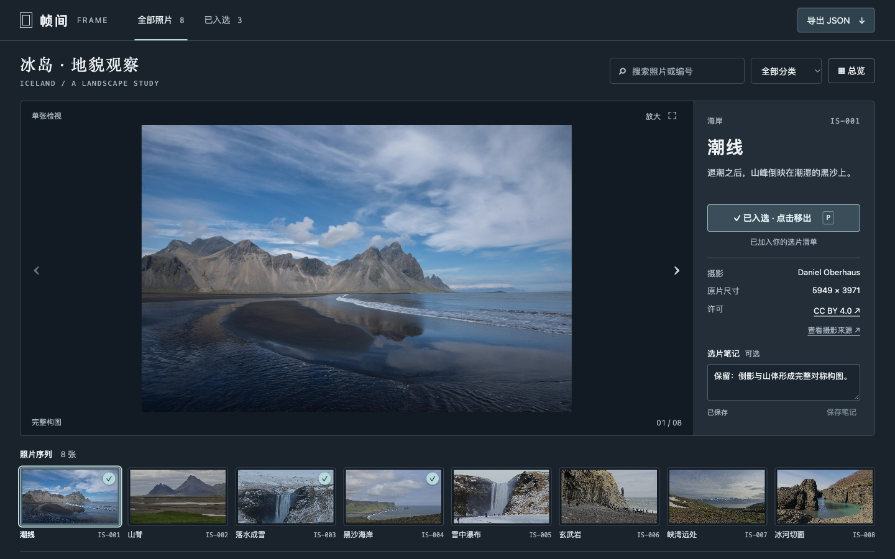
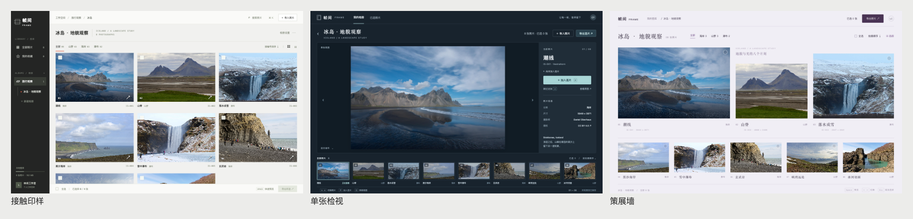
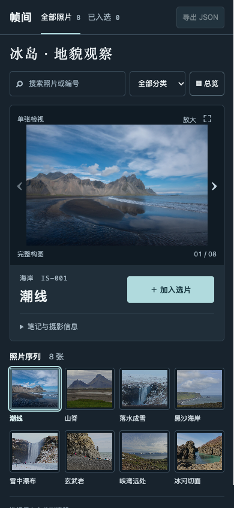

# 帧间 FRAME · 摄影选片工作台

由 Codex 使用已实际加载的 Codex LLY UI **0.6.0** 完成。页面不是图片模型生成的 UI 截图：布局、按钮、状态、存储与导出均为可运行 HTML/CSS/JavaScript。

**[打开真实页面](https://a789b1.github.io/codex-lly-ui/)** · [三个方向同屏比较](https://a789b1.github.io/codex-lly-ui/directions/style-explorer.html) · [实际交互录屏](https://a789b1.github.io/codex-lly-ui/evidence/motion/watch.html)



## 实际完成的流程

1. 当前会话直接调用插件状态工具确认 0.6.0 生效，读取安装目录技能。
2. 实际浏览 Pixieset 和 Picflow 的画廊、检视与工作区，记录具体布局、控件和任务取舍：[参考研究](research/NOTES.md)。
3. 同一批照片做三个独立首屏：接触印样、单张检视、策展墙。渲染后比较，选单张检视：[设计决定](DESIGN.md)。
4. 实现搜索、分类、单张/总览、入选、笔记、大图与键盘操作、刷新恢复、保存失败重试、JSON 清单导出。
5. 独立视觉评审及独立 UX 走查；按反馈改善平板照片面积、手机控件层级和切片后返回位置。
6. 主 Agent 实测桌面、手机、异常恢复和导出内容；三次独立浏览器运行检查保存失败恢复。



<details><summary>手机实际效果</summary>



</details>

## 本地运行

在仓库根目录运行：

```sh
python3 -m http.server 4175 --bind 127.0.0.1 --directory demo/frame
```

打开 `http://127.0.0.1:4175/`。无需依赖安装。页面只在当前浏览器存储选片与笔记；不上传照片或用户内容。GitHub Pages 与本地是不同来源，选择记录不共享。

快捷键：左右箭头切片，P 切换入选，G 总览，空格打开大图（焦点在按钮时保留按钮原生操作），Esc 关闭大图。手机通过可见按钮操作。

## 来源与边界

界面、交互和本次演示记录由 Codex 创建。冰岛摄影来自 Wikimedia Commons，**不是 Codex 生成的摄影，也不是开发者拍摄**。每张照片保留作者、原片尺寸、来源和 CC 许可，见 [素材说明](assets/SOURCES.md)。本项目 MIT 许可不替代这些照片各自的许可。

相册名称、照片中文编目名和笔记是演示内容；照片的尺寸为来源记录中的原作尺寸，页面使用 1920px 的许可缩略版本。无云同步、账号或客户审批系统。

独立视觉评分属于评审意见，不是客观性能指标；自动审计保留待人工核对的符号项，不宣称全面无障碍认证。完整证据与剩余限制见 [验收记录](ACCEPTANCE.md)。
